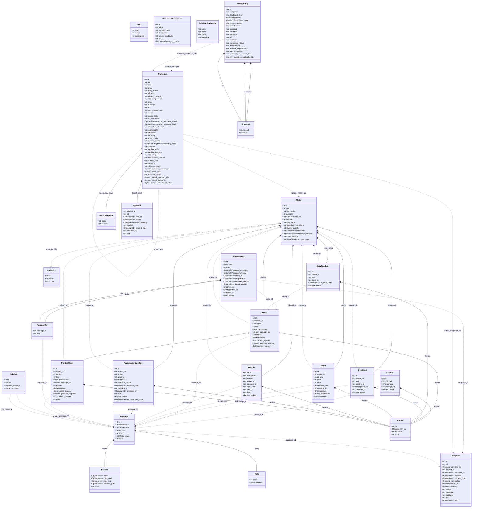

# Muni data model (UML)

Generated from `pipeline/models.py` by `python3 pipeline/models.py --uml`. Don't edit by hand.

Solid diamonds mean one record contains the other. Dotted arrows mean a field holds the other record's id.

